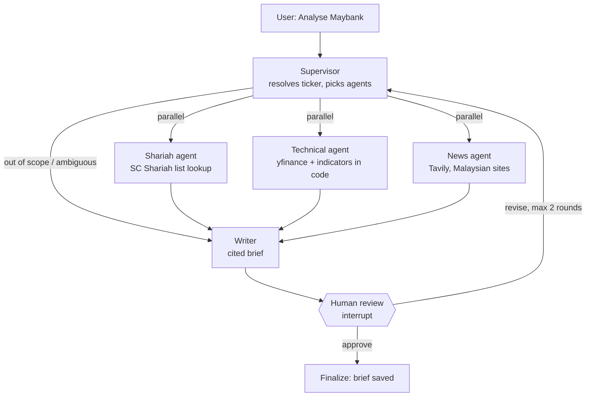

# HalalLens

> A multi-agent research assistant for Bursa Malaysia stocks. It returns a cited brief on Shariah status, technicals and news, and a human approves every brief.

<!-- TODO(week 6): GIF of a full run here -->

**Live demo:** _TODO_ · **2-minute video:** _TODO_

Research only. HalalLens never places trades and never gives buy or sell calls.

## How it works



One LangGraph `StateGraph` ([app/graph/graph.py](app/graph/graph.py)). Langfuse traces every step, and a checkpointer saves state after each one.

## Design decisions

- **The SC list is the source of truth for Shariah status.** The Shariah agent looks the status up in the Securities Commission Malaysia list and cites it, with the list date. No LLM ever judges compliance.
- **Numbers come from code.** Support and resistance, moving averages, RSI and candle patterns are computed in pandas ([app/tools/indicators.py](app/tools/indicators.py)). The LLM only explains them, and an evaluator checks that every number in the brief appears in the tool output.
- **Parallel specialist agents.** Each agent has one or two tools and a narrow prompt, so it is easier to test, cheaper to run and easier to read in traces. Each one writes to its own state key, so the parallel branches never collide.
- **Human in the loop.** `interrupt()` pauses the run before anything is final. The reviewer approves the brief or asks for a revision, and a revision re-runs only the agents that are needed.

## Evaluation

<!-- TODO(week 5): fill in from evals/run_experiment.py; add a Langfuse trace screenshot -->

| Version | What changed | ticker_correct | shariah_correct | numbers_grounded | no_advice | cost / brief |
|---|---|---|---|---|---|---|
| v0.1 | Baseline | | | | | |
| v0.2 | Fuzzy ticker resolver | | | | | |
| v0.3 | Structured output for writer | | | | | |

## Quickstart

```bash
cp .env.example .env          # add your API keys
docker compose up --build     # API on :8000, UI on :8501
```

Local development:

```bash
uv sync                                   # or, without uv:
                                          # python -m venv .venv && .venv\Scripts\activate
                                          # pip install -r requirements.txt   (then drop "uv run" below)
uv run python scripts/parse_sc_list.py data/raw/sc_list.pdf --list-date 2026-05-29
uv run uvicorn app.api.main:app --reload
uv run streamlit run ui/streamlit_app.py
uv run pytest
```

## Limitations

- `yfinance` is unofficial and can break or rate-limit. Calls are retried and cached for a day, and a stale cache is flagged in the brief.
- Shariah status is a snapshot of the latest SC list (updated on the last Friday of May and November). Every brief prints the list date.
- News sentiment is judged by an LLM and can be wrong. The brief lists the headlines it used so you can check them.
- Ticker resolution covers the SC list and a small alias map. A non-compliant stock that is not in the alias map cannot be resolved yet.

**Disclaimer:** HalalLens provides research only, not financial advice.
