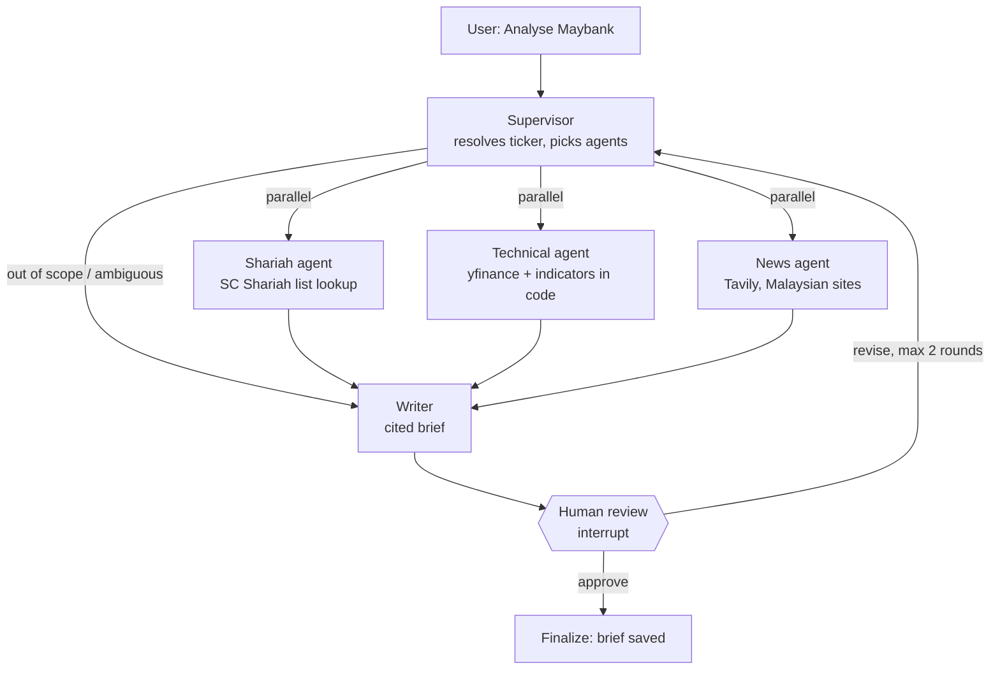

# HalalLens

> A multi-agent research assistant for Bursa Malaysia stocks. It returns a cited brief on Shariah status, technicals and news, and a human approves every brief.

<!-- TODO(week 6): GIF of a full run here -->

**Live demo:** _TODO_ · **2-minute video:** _TODO_

Research only. HalalLens never places trades and never gives buy or sell calls.

## How it works



One LangGraph `StateGraph` ([app/graph/graph.py](app/graph/graph.py)). Langfuse traces every step, and a checkpointer saves state after each one.

## Design decisions

- **The SC list is the source of truth for Shariah status.** The Shariah agent looks the status up in the Securities Commission Malaysia list and cites it, with the list date. No LLM ever judges compliance.
- **Numbers come from code.** Support and resistance, moving averages, RSI and candle patterns are computed in pandas ([app/tools/indicators.py](app/tools/indicators.py)). The LLM only explains them, and an evaluator checks that every number in the brief appears in the tool output.
- **Parallel specialist agents.** Each agent has one or two tools and a narrow prompt, so it is easier to test, cheaper to run and easier to read in traces. Each one writes to its own state key, so the parallel branches never collide.
- **Human in the loop.** `interrupt()` pauses the run before anything is final. The reviewer approves the brief or asks for a revision, and a revision re-runs only the agents that are needed.

## Evaluation

<!-- TODO(week 5): fill in from evals/run_experiment.py; add a Langfuse trace screenshot -->

| Version | What changed | ticker_correct | shariah_correct | numbers_grounded | no_advice | cost / brief |
|---|---|---|---|---|---|---|
| v0.1 | Baseline | | | | | |
| v0.2 | Fuzzy ticker resolver | | | | | |
| v0.3 | Structured output for writer | | | | | |

## Quickstart

```bash
cp .env.example .env          # add your API keys
docker compose up --build     # web UI on http://localhost:8080, API on :8010
```

Local development:

```bash
uv sync                                   # or, without uv:
                                          # python -m venv .venv && .venv\Scripts\activate
                                          # pip install -r requirements.txt   (then drop "uv run" below)
uv run python scripts/parse_sc_list.py data/raw/sc_list.pdf
uv run python scripts/check_setup.py      # checks data files and API keys
uv run uvicorn app.api.main:app --reload --port 8010  # API on :8010 (8000 is left free)

cd ui/halallens-ui && npm install && npm run dev   # web UI on http://localhost:5180

uv run pytest
```

Ports (chosen to avoid other local projects that use 4000, 5173, 4173, 8000, 5432 and 6379):

| Service | Port |
|---|---|
| API (uvicorn) | 8010 |
| Web UI, dev (`npm run dev`) | 5180 |
| Web UI, preview (`npm run preview`) | 4180 |
| Web UI in docker compose | 8080 |
| Postgres in docker compose | internal only |

The web UI is in [ui/halallens-ui](ui/halallens-ui/README.md). It falls back to a labelled demo mode
when the API isn't running.

## Deploy

**Web UI on Vercel.** It is free, and it runs the labelled demo mode until a backend is connected.

1. On vercel.com, choose **Add New → Project** and import this GitHub repo.
2. Set **Root Directory** to `ui/halallens-ui`. The framework (Vite), build command and output directory come from `vercel.json`.
3. Deploy. Every push to `main` redeploys.

**Backend.** The backend needs a long-running server, not serverless functions, because a run streams for about 30 seconds and the LangGraph checkpoint must survive between the draft and your approval.

- Deploy the root `Dockerfile` (port 8010) to Render, Railway or Fly.io, with Postgres on Neon or Supabase through `DATABASE_URL`.
- Set `CORS_ORIGINS=https://<your-app>.vercel.app` on the backend and `VITE_API_BASE=https://<your-backend>` on Vercel, then redeploy the UI.
- Before making the backend public, add rate limiting (TODO in `app/api/main.py`) and set a spend limit on your LLM provider. Saved briefs are written to disk, so use a host with a persistent disk or move them to Postgres.

## Limitations

- `yfinance` is unofficial and can break or rate-limit. Calls are retried and cached for a day, and a stale cache is flagged in the brief.
- Shariah status is a snapshot of the latest SC list (updated on the last Friday of May and November). Every brief prints the list date.
- News sentiment is judged by an LLM and can be wrong. The brief lists the headlines it used so you can check them.
- Ticker resolution covers the SC list and a small alias map. A non-compliant stock that is not in the alias map cannot be resolved yet.

**Disclaimer:** HalalLens provides research only, not financial advice.
